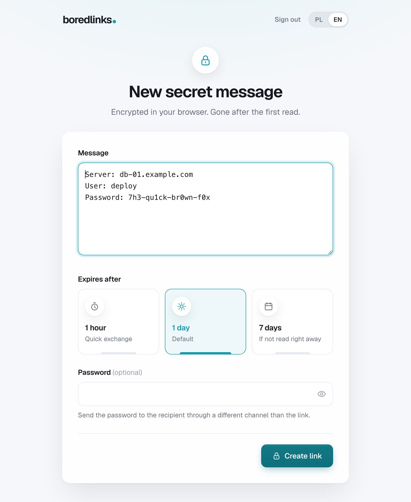

<h1 align="center">
  <picture>
    <source media="(prefers-color-scheme: dark)" srcset="docs/logo-dark.png">
    
  </picture>
</h1>

One-time encrypted links for passing secrets (passwords, keys, login details). You write a message, get a link, send it. The message can be opened once and then it is gone.

<p align="center"></p>

Self-hosted, single-user: only the owner creates links, recipients open them without an account. Plain PHP and SQLite, no framework, no build step, nothing loaded from a CDN. Interface in English and Polish.

## How it works

- The message is encrypted **in the browser** (WebCrypto, AES-256-GCM) with a random 256-bit key.
- The key lives only in the `#fragment` of the link, which browsers never send to the server. The server stores ciphertext it cannot read.
- Opening a message returns the ciphertext and deletes it in the same database transaction, so a second open gets nothing. Opening needs a button click (a POST), so link previews in chat apps do not consume the message.
- Optional password: the AES key becomes `SHA-256(link key || PBKDF2-SHA256(password, salt, 600 000 iterations))`. Send the password through a different channel than the link.
- Unopened messages expire after 1 hour, 1 day or 7 days.

## Requirements

- PHP 8.1+ with `pdo_sqlite` and `mbstring`
- Apache or LiteSpeed with `mod_rewrite` (`public/.htaccess`), or any server that sends every request for a non-existing file to `public/index.php`
- HTTPS (WebCrypto does not work without it, except on `localhost`)
- The application must sit at the root of a domain or subdomain, not in a subfolder

## Install

1. Run `bin/package.sh`. It builds `dist/domena/`: `public_html/` is the web root, and `src/`, `pages/`, `lang/`, `bin/` go **next to it**, outside the web root. Without a shell, copy the folders by hand in the same layout (`public/` becomes the web root).
2. Upload it. PHP must be able to write to the folder above the web root: it creates `config.php` and `data/` there.
3. Open the site and set your password (at least 12 characters). This form exists only until `config.php` is created, so do it right after uploading. With shell access you can run `php bin/setup.php` instead.
4. Optional: a cron job for `php bin/cleanup.php` (hourly is enough) removes expired messages. They are also removed whenever a message is created or opened.

Changing the password: run `php bin/setup.php` again, or delete `config.php` on the server and open the site. Either way all devices are logged out.

Updating: upload the new files. `config.php` and `data/` are not part of the package and stay untouched.

## Run locally

```
php -S 127.0.0.1:8000 -t public public/index.php
```

Tests: `php tests/run.php` (storage, login, languages) and `node tests/crypto.test.mjs` (encryption, needs Node.js).

## Security notes

- The server never sees the message or the key. Someone who steals the database gets ciphertext only.
- Like every tool that encrypts in the browser, it relies on the server delivering honest JavaScript. Whoever controls your hosting can replace `app.js` and capture future messages. Host it somewhere you trust.
- Login attempts are limited to 10 per 15 minutes per IPv4 address or IPv6 /64. Behind Cloudflare the visitor address is taken from `CF-Connecting-IP`, and only when the connection really comes from Cloudflare.
- The scheme is taken from `X-Forwarded-Proto` when present, which is right behind a TLS-terminating proxy.
- The ciphertext length reveals the approximate length of the message to the server.
- Whoever opens the link first gets the message. If the recipient finds it already gone, treat the secret as exposed.

Found a security problem? Please open an issue, or contact the author privately first if it is serious.

## License

MIT - see [LICENSE](LICENSE). The bundled Geist font is under the SIL Open Font License (`public/assets/fonts/Geist-OFL.txt`).
